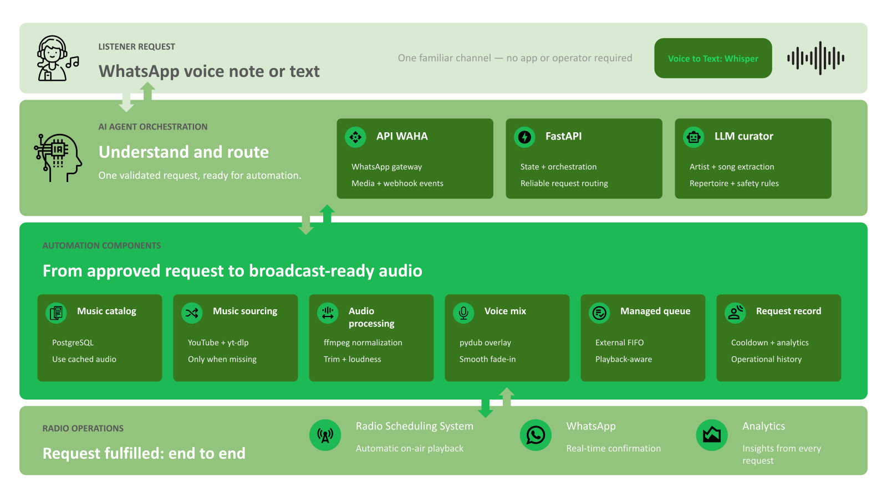
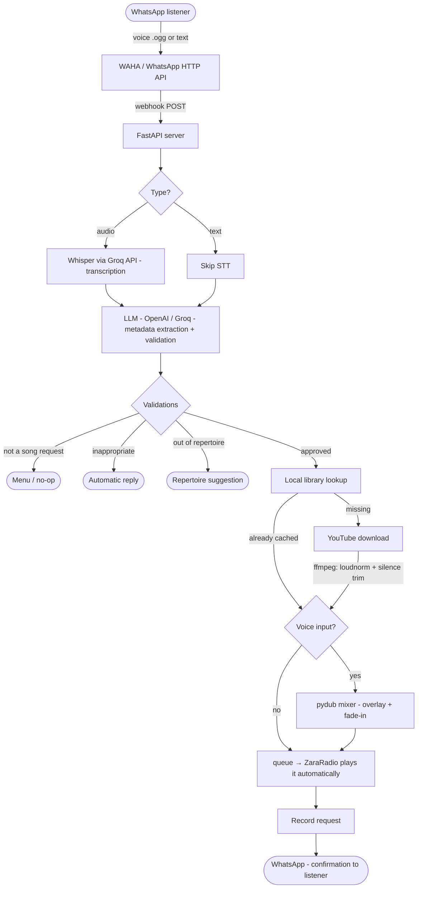

# Virtual Music Agent

> Listeners request songs over WhatsApp. The agent curates each request against the radio station's profile and plays it automatically — end to end, with no human in the loop.

This is a production system built for **Luz FM**, a Brazilian FM station focused on the 30+ "flashback" audience. It is published here as a portfolio piece.

> **Note on language:** this README and the public technical documentation are written in English. Listener-facing messages, prompts, and parts of the domain implementation remain in **Brazilian Portuguese** because the system was built and tuned for a Brazilian radio station.

---

## Overview

A radio station was receiving dozens of song requests per day over WhatsApp — voice notes and text, arriving unsorted, with no triage and no automation. The whole process was manual: a host listened to each audio, identified the song, searched the library, and replied to the listener. At peak hours requests were lost.

This agent closes the full loop automatically:

- Receive requests over WhatsApp (voice or text)
- Understand what the listener wants, even with accents and background noise
- Validate the request against the station's repertoire (30+ flashback)
- Find the song in the local library or download it on demand
- Mix the listener's voice with the requested song using a smooth transition
- Deliver the file straight to the broadcast software's queue
- Reply to the listener with a real-time confirmation

It also ships with a **web analytics dashboard** (Next.js) for the station owner, including cross-filtering charts and an AI insights panel.

---

## Architecture

### Request pipeline



The architecture is organized into four layers: listener input, AI orchestration, audio automation, and radio-station outputs. Voice and text follow the same path after transcription, while rejected or ambiguous requests are handled as automatic WhatsApp responses without entering the audio-production stages.

<details>
<summary><strong>Detailed technical flow (7 steps)</strong></summary>

<br>



</details>

1. **STT** ([core/stt.py](core/stt.py)) — transcribes the `.ogg` voice note via the **Groq Whisper API** (no local model).
2. **LLM** ([core/intelligence.py](core/intelligence.py)) — extracts artist/song and applies business rules (is it a request? is it in repertoire? is it appropriate?). The provider is OpenAI or Groq, selected automatically from the configured keys. Prompt lives in [core/config_radio.py](core/config_radio.py).
3. **Library** ([core/database.py](core/database.py)) — looks the song up in PostgreSQL with accent/case-insensitive matching.
4. **Download** ([core/downloader.py](core/downloader.py)) — if missing, downloads from YouTube via `yt-dlp` and normalizes with `ffmpeg` (loudnorm to -14 LUFS, silence trim).
5. **Mixer** ([core/audio_mixer.py](core/audio_mixer.py)) — overlays the listener's voice over the song with a smooth fade (`pydub`).
6. **Delivery** ([core/queue_watcher.py](core/queue_watcher.py)) — an external FIFO queue feeds ZaraRadio one file at a time and detects playback end (CurrentSong.txt + timer).
7. **Record** — saves the request for the 6-hour per-listener cooldown and for analytics.

Around the pipeline, [server.py](server.py) runs the FastAPI webhook, a per-listener conversation state machine, health checks, a weekly report, and automatic WAHA session reconnection.

---

## Stack

**Backend**

```
Python 3.13      FastAPI            pydub
Whisper (Groq)   yt-dlp / ffmpeg    PostgreSQL (Supabase)
OpenAI / Groq    WAHA (Baileys)     Docker Compose
```

**Dashboard** (`dashboard-web/`)

```
Next.js 14       TypeScript         Recharts
React 18         pg (PostgreSQL)    Tailwind CSS
```

---

## Project structure

```
gpteco/
├── core/
│   ├── pipeline.py        # main orchestrator (7 steps)
│   ├── stt.py             # transcription via Groq Whisper API
│   ├── intelligence.py    # LLM: metadata extraction + validations
│   ├── config_radio.py    # station identity, listener messages, LLM prompt
│   ├── downloader.py      # yt-dlp + ffmpeg (loudnorm -14 LUFS)
│   ├── audio_mixer.py     # pydub: overlay + fade-in
│   ├── database.py        # PostgreSQL: library + requests + cooldown
│   ├── queue_watcher.py   # FIFO queue for ZaraRadio
│   ├── curador.py         # music-trivia "pills" (optional follow-up message)
│   ├── relatorio.py       # analytics + weekly report
│   └── whatsapp.py        # WAHA client (download audio + send messages)
├── server.py              # FastAPI: webhook + background tasks + health
├── main.py                # CLI entry point (single request)
├── scripts/               # one-off DB backfills (genre, phone resolution)
├── dashboard-web/         # Next.js analytics dashboard
├── docker-compose.yml         # local dev (builds the image)
├── docker-compose.dist.yml    # client deployment (prebuilt image)
├── instalar.bat           # Windows installer for client deployment
├── Dockerfile
├── .env.example
└── requirements.txt
```

---

## Installation & running

### Prerequisites

- Docker and Docker Compose (recommended path), **or** Python 3.13 + `ffmpeg` for local runs
- A PostgreSQL database (the project uses [Supabase](https://supabase.com))
- A [Groq](https://console.groq.com) API key (free) and/or an [OpenAI](https://platform.openai.com) API key

### Backend (Docker — recommended)

```bash
# 1. Configure the environment
cp .env.example .env
#    then fill in: GROQ_API_KEY (or OPENAI_API_KEY), DATABASE_URL, WAHA_API_KEY, ...

# 2. Start the stack (FastAPI server + WAHA + Uptime Kuma)
docker compose up -d

# 3. Connect WhatsApp: open the WAHA dashboard and scan the QR code
#    http://localhost:3001/dashboard   (login: admin / WAHA_API_KEY)

# Useful:
docker compose logs -f servidor      # follow logs
docker compose down                  # stop
```

Services after startup:

| Service     | URL                                   | Purpose                          |
|-------------|---------------------------------------|----------------------------------|
| FastAPI     | http://localhost:8002/health          | webhook + health check           |
| WAHA        | http://localhost:3001/dashboard       | WhatsApp gateway (QR / sessions) |
| Uptime Kuma | http://localhost:3002                 | uptime monitoring                |

> `docker-compose.dist.yml` is an alternative for client machines: it pulls a prebuilt image instead of building locally, and `instalar.bat` automates the whole setup on Windows.

### Backend (local, without Docker)

```bash
python -m venv .venv && source .venv/bin/activate
pip install -r requirements.txt          # ffmpeg must be installed and on PATH

cp .env.example .env                      # fill in your keys
uvicorn server:app --host 0.0.0.0 --port 8002
```

You can also process a single request from the command line:

```bash
python main.py --numero 5511999999999 --texto "Quero ouvir Evidências do Chitãozinho e Xororó"
python main.py --numero 5511999999999 --ogg path/to/voice.ogg
```

### Dashboard (`dashboard-web/`)

```bash
cd dashboard-web
npm install
cp .env.local.example .env.local          # set DATABASE_URL (and OPENAI_API_KEY for AI insights)
npm run dev                               # http://localhost:3000
```

The public homepage at `/` presents AKAPO and its plans. `/painel` and `/insights` read the same PostgreSQL database and render request analytics (audience heatmap, top genres, fulfillment rate, daily volume) with cross-filtering and an optional AI insights panel. Only the dashboard routes load analytics; the homepage does not depend on the database.

Set `NEXT_PUBLIC_CONTACT_WHATSAPP` in `dashboard-web/.env.local` before building to send sales inquiries to WhatsApp (country code + area code + number). When it is empty or invalid, the buttons use `NEXT_PUBLIC_CONTACT_EMAIL`, which defaults to `contato@akapo.com.br`. These public values are embedded at build time. The plan cards describe the commercial offer; they do not implement billing or subscription access control.

### Tests

```bash
pip install -r requirements.txt pytest
python -m pytest -q tests
python -m core.luzia.schema

cd dashboard-web
npm run build
```

The Python suite uses local fixtures and fakes for external services. It includes repertoire rules, removal of election-era blocks, optional voice invitations, YouTube throttling, WAHA recovery and delivery-result regression tests. Live WhatsApp, downloads, audio playback and database integration still need their own environment checks.

### Request rules and models on the client PC

Election-era restrictions on song titles, artists and candidate names have been removed from the pipeline, classifier profile and Docker installation. Existing `eleitoral.json` files and `ELEITORAL_LISTA_*` settings are no longer read. Historical rejection records remain available in analytics.

After the second successful text request, the confirmation includes an optional invitation to send future requests by voice. Text remains accepted. Further successful text requests include the invitation until a voice request resets the count. Only fulfilled requests in `CANAL_HISTORICO_DIAS` count; rejected requests and unknown legacy channels do not. The old `CANAL_TEXTO_MAX`, `CANAL_BLOQUEIO_MIN` and `CANAL_JANELA_MIN` settings no longer apply. `CANAL_VOZ_ATIVADO=false` disables only the invitation. The general cooldown and repertoire rules still apply.

On an existing Docker installation, edit the client's `.env` to change responses and musical curiosities to GPT-5.6:

```dotenv
COMPOSER_MODELO=gpt-5.6
PILULAS_MODELO=gpt-5.6
PILULAS_CONTEXTO_MODELO=gpt-5.6
```

Keep `LLM_MODEL` unchanged: it controls identification of requests. `OPENAI_API_KEY` must be configured. New code defaults use GPT-5.6 for these three writing tasks, while explicit client settings retain priority. The API's [`gpt-5.6` alias routes to GPT-5.6 Sol](https://developers.openai.com/api/docs/models/gpt-5.6-sol). Short responses and curiosity personalization disable reasoning so their output budget is reserved for the listener-facing text. Previously cached curiosities are retained; the model change applies to new generations.

The listener-facing voice is **Lu**, Luz FM's female virtual assistant with the warmth and conversational rhythm of a radio host. Edit the tone, fixed replies, curiosity heading, and contextual bridges in [`core/luzia/luzia.md`](core/luzia/luzia.md). Generated replies, new musical curiosities, and contextual bridges all read the profile's tone at request time. On installations with `ASSISTANT_PROFILE_PATH`, update that mounted profile to apply the new wording; it takes precedence over the bundled file. The curiosity generator also needs this updated application code to read the shared tone. Existing cached curiosity texts are retained, with the current profile's heading applied when sent. Personalization preserves the original curiosity and adds only a short bridge to context the listener actually provided. Request classification and acceptance rules are independent of this voice.

After the updated server image is published and the updated `docker-compose.dist.yml` is on the client PC:

```bash
docker compose -f docker-compose.dist.yml pull servidor
docker compose -f docker-compose.dist.yml up -d --no-deps --force-recreate servidor
docker compose -f docker-compose.dist.yml logs --tail=100 servidor
```

Recreating the service is necessary to load changes from `.env`; a restart alone keeps its old environment. Keep the radio's customized `assistente.md`: if it lacks `## sugestao_voz`, the new code uses a built-in invitation, without requiring the profile to be overwritten.

For the Windows upgrade to `iamlucb/gpteco:main-12758fb`, run
[`scripts/atualizar-lu-12758fb.ps1`](scripts/atualizar-lu-12758fb.ps1) from the
existing installation directory. It checks the image revision, backs up the
current environment and profile under `%LOCALAPPDATA%\gpteco\backups`, and
prepares a versioned profile while preserving the radio metadata, repertoire,
and hard rules. It updates the writing models and YouTube client, recreates
only `servidor`, and restores the previous configuration if startup or final
verification fails. The new profile path is saved in `ASSISTANT_PROFILE_FILE`;
the previous profile stays available for rollback.

The LangGraph conversation experiment remains isolated on `codex/conversational-experiment`; it is not included in these changes based on `main`.

### PO Token provider compatibility

The YouTube player client defaults to `default`, allowing yt-dlp to select
its supported clients. If an existing installation explicitly sets
`YT_PLAYER_CLIENT=tv_simply`, change it to `YT_PLAYER_CLIENT=default` and
recreate only `servidor` to load the setting. In the November 16 production
diagnosis, `tv_simply` returned HTTP 403 with yt-dlp 2026.08.19 and 2026.10.26;
the default clients downloaded the full audio with both versions, and the
installed version completed a real listener request after this change.

The `bgutil-pot` HTTP server image and the Python `bgutil-ytdlp-pot-provider`
plugin are both pinned to **1.3.2**. Keep them aligned: the provider's
[1.3.2 release](https://github.com/Brainicism/bgutil-ytdlp-pot-provider/releases/tag/1.3.2)
fixes token generation for YouTube sessions where metadata and token requests
succeed but media downloads return HTTP 403.

An existing client with plugin 1.3.2 and provider 1.3.1 can update only the
`bgutil-pot` image to `brainicism/bgutil-ytdlp-pot-provider:1.3.2` in its existing
`docker-compose.dist.yml`. Back up that file first, validate it with
`docker compose -f docker-compose.dist.yml config --quiet`, then run:

```bash
docker compose -f docker-compose.dist.yml pull bgutil-pot
docker compose -f docker-compose.dist.yml up -d --no-deps --force-recreate bgutil-pot
docker compose -f docker-compose.dist.yml logs --no-color --timestamps --tail=30 bgutil-pot
```

These commands target the token provider and retain the client's current
server image. Do not deploy this repository's whole Compose file just for
this maintenance. Validate media access after the update: a successful
`yt-dlp --simulate` run only verifies extraction and format selection. A small
HTTP range request verifies partial media access; it can succeed while a
normal download still fails. Validate a full download into a temporary
directory, then confirm a real listener request through the radio queue.

For rollback, restore the backed-up Compose file and recreate only
`bgutil-pot` again. The previous provider image should remain available
locally; avoid removing it until verification is complete.

---

## Results

This system ran in production for a real FM station. Reported honestly:

- **Full end-to-end automation validated in production:** listener voice → request identified → song downloaded → mixed → ZaraRadio queue, with no human intervention.
- **Robust to noisy input:** the LLM normalizes phonetic errors from speech-to-text (e.g. "morder talk" → "Modern Talking") and asks for confirmation when unsure.
- **Repertoire-aware:** requests are validated against the station's genre rules with a chain-of-thought step before the decision.
- **Local caching:** once a song is downloaded and normalized, future requests for it are served instantly from the library.
- **Operational resilience:** the queue watcher self-restarts via a watchdog, the WhatsApp session auto-reconnects, and `/health` reports WAHA, database, queue and disk status.
- **Owner-facing analytics:** a weekly WhatsApp report plus a web dashboard with cross-filtering and AI-generated insights.

### Limitations & honesty notes

- **No benchmark numbers are claimed here.** Latency depends on whether the song is cached and on third-party APIs (Groq/OpenAI, YouTube), so I am not publishing timing figures I cannot reproduce from artifacts in this repo.
- **Delivery and database recording are separate operations.** Once a song is queued, a subsequent recording failure preserves the successful delivery result and returns `codigo="registro_pendente"`, with an operational log. There is no automatic retry of that recording; database-backed cooldown and analytics depend on it being saved.
- **External dependencies:** the system relies on WAHA (WhatsApp), Groq/OpenAI, a YouTube source for downloads, and a PostgreSQL instance.
- **ZaraRadio integration is Windows/file-based:** delivery targets ZaraRadio through a watched folder and its `CurrentSong.txt`, which is specific to that broadcast software.

---

## License

[MIT](LICENSE) © Lucas Borges
